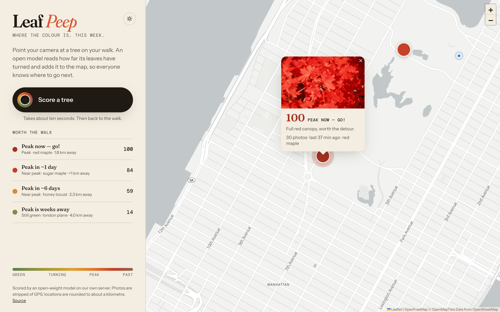

# Leaf Peep



**Where the colour is, this week.**

Snap a tree on your walk. An open-weight vision model (Gemma 4) reads how far its leaves have turned, and the photo lands on a shared map of where fall foliage is peaking. A Tiger Data hypertable keeps the colour history for each spot and forecasts when it will peak, so the next person knows where to walk this weekend.

Ten seconds on the screen, then back outside.

## How it works

```
phone camera ──► Express API ──► Gemma 4 (DigitalOcean serverless inference, or Ollama locally)
                      │                 └─ returns stage, colour score 0–100, colours, tree guess
                      ├─► photo storage         (Droplet volume or Spaces; re-encoded so no EXIF/GPS survives)
                      └─► Tiger Data / TimescaleDB
                              sightings      hypertable, location rounded to a ~1 km cell
                              cell_daily     continuous aggregate: daily colour per cell
                              forecast       regr_slope over the daily series → "peak in ~N days"
```

- **Scoring:** `src/model.js` sends the photo to Gemma with a JSON schema, so the reply is always structured. It talks to Ollama's API by default, or any OpenAI-compatible endpoint with `MODEL_API=openai`.
- **Privacy:** the server re-encodes every photo, which strips EXIF and GPS, and stores only a ~1 km grid cell, never the exact location. Add `?at=lat,lng` to the URL to override the device location entirely.
- **Forecast:** `src/db.js` fits a least-squares trend to each cell's daily average colour and projects when it crosses the peak threshold (85).

## Run it locally

```bash
# 1. Open model
ollama pull gemma4

# 2. TimescaleDB
docker run -d --name leafpeep-db -p 5433:5432 \
  -e POSTGRES_PASSWORD=leafpeep -e POSTGRES_DB=leafpeep timescale/timescaledb-ha:pg17
docker exec -i leafpeep-db psql -U postgres -d leafpeep < db/schema.sql
# optional: synthetic history so the forecast has something to show (local only)
docker exec -i leafpeep-db psql -U postgres -d leafpeep < db/dev-seed.sql

# 3. App
npm install
npm run dev        # http://localhost:8080
```

Photos are saved to `./uploads` unless `SPACES_BUCKET` is set.

## Deploy on DigitalOcean

A $12/month Droplet runs Caddy (automatic HTTPS), the app and TimescaleDB. Scoring calls **Gemma 4 on DigitalOcean serverless inference**, so no GPU is needed and you pay per photo (well under a tenth of a cent each).

```bash
cp .env.example .env     # set MODEL_KEY (a Model Access Key limited to Gemma 4)
./deploy/up.sh           # creates the Droplet, deploys, prints https://<ip>.sslip.io
./deploy/down.sh         # destroys it so billing stops
```

To use Tiger Cloud instead of the bundled TimescaleDB, set `DATABASE_URL`. To keep photos in Spaces, set `SPACES_*`. To self-host the model on a GPU Droplet, set `MODEL_API=ollama` and run compose with `--profile ollama`.

## Stack

Gemma 4 · DigitalOcean (serverless inference, Droplet) · Ollama for local dev · Tiger Data (TimescaleDB) · Node + Express · Leaflet + MapLibre with OpenFreeMap tiles

## License

MIT
