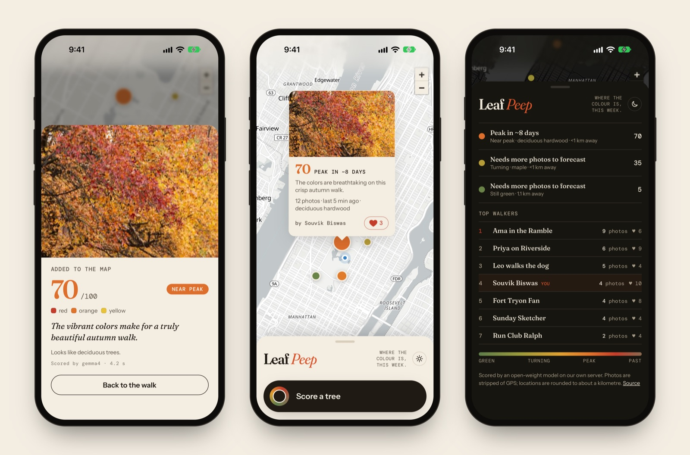
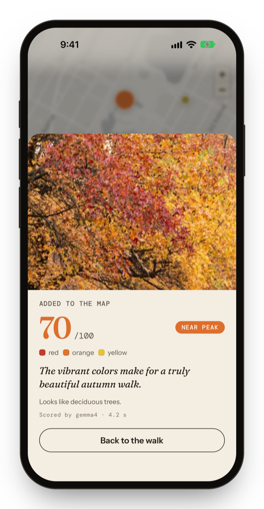
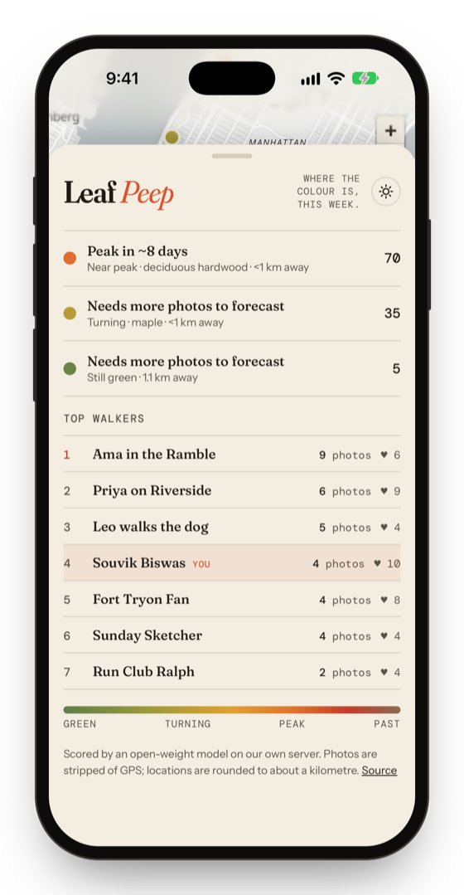
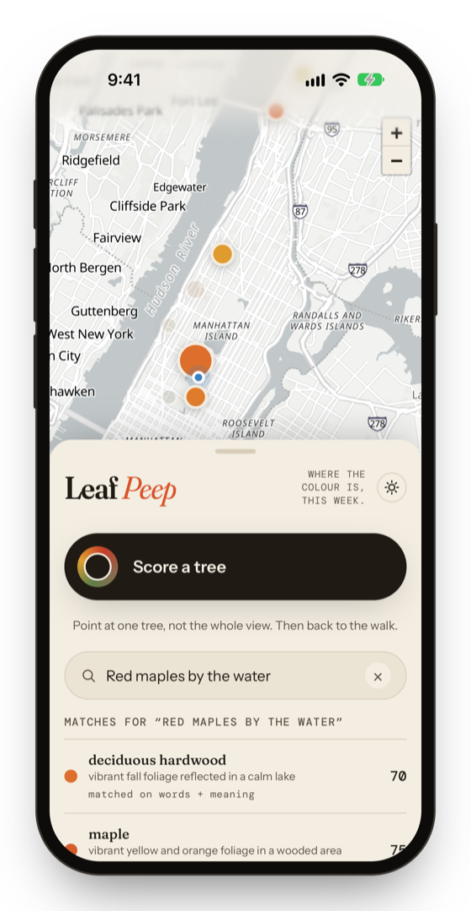
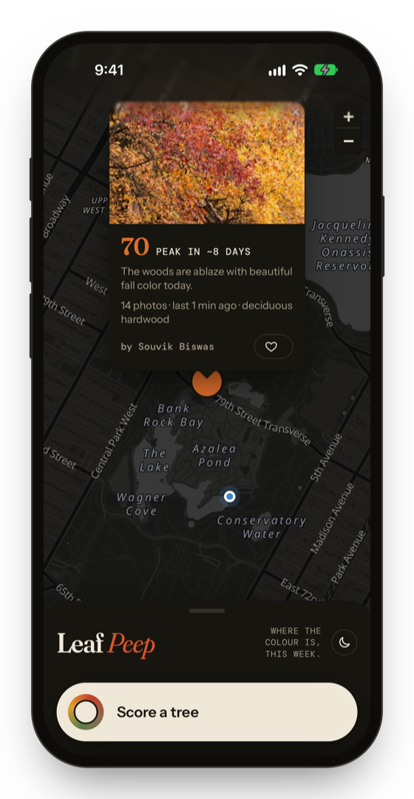
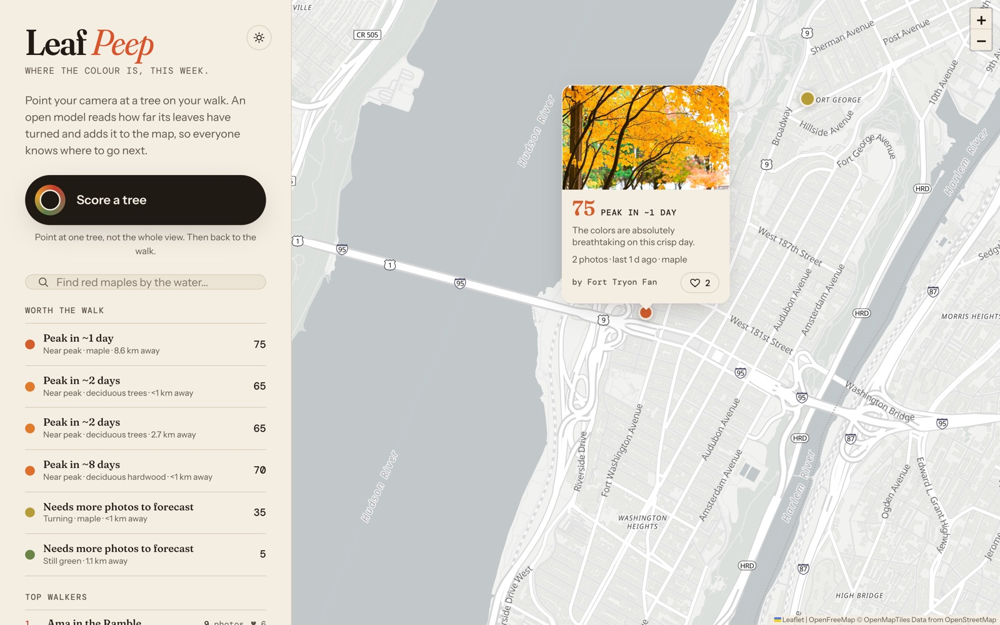
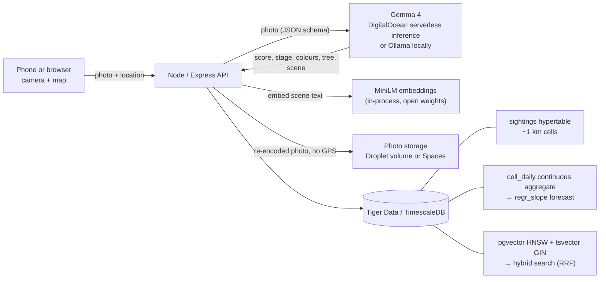

# Leaf Peep

**Where the colour is, this week.** Snap a tree on your walk. Gemma 4, an open-weight vision model, reads how far its leaves have turned, and the spot lands on a shared map of where fall foliage is peaking, with a forecast for when each spot will peak.



**[Open the app](https://leafpeep.souvikbiswas.com)** · **[Landing page](https://sbis04.github.io/leaf-peep/)** · **[Demo video](https://youtu.be/uMD2_-Qsu6A)** · Built for the [Hacktoberfest 2026 Open-Source AI Challenge: Touch Grass](https://dev.to/challenges/hacktoberfest-week1-2026-10-05)

## What it does

<table>
<tr><th width="25%">Score a tree</th><th width="25%">Likes and leaderboard</th><th width="25%">Hybrid search</th><th width="25%">Dark mode</th></tr>
<tr><td width="25%" align="center"></td><td width="25%" align="center"></td><td width="25%" align="center"></td><td width="25%" align="center"></td></tr>
<tr><td width="25%" valign="top">Camera first, any name on your first photo (no account). Gemma 4 returns a 0–100 colour score, a stage, the colours it sees and a tree guess.</td><td width="25%" valign="top">Like other walkers' trees; the board ranks walkers by photos, then likes.</td><td width="25%" valign="top">“Red maples by the water” finds lakeside maples: pgvector for meaning plus Postgres full-text for words.</td><td width="25%" valign="top">Follows the system theme. Draggable bottom sheet on phones, side panel on wide screens. Installable to the Home Screen.</td></tr>
</table>



## Architecture



- **Scoring** (`src/model.js`): the photo is downscaled, re-encoded (which strips EXIF and GPS) and sent to Gemma with a JSON schema, so the reply is always structured. `MODEL_API=openai` targets any OpenAI-compatible endpoint, such as DigitalOcean serverless inference. `MODEL_API=ollama` targets a local model.
- **Forecast** (`src/db.js`): `sightings` is a hypertable keyed to a ~1 km grid cell, so exact GPS is never stored. `cell_daily` is a continuous aggregate of each cell's daily average colour, with real-time mode for today. A least-squares fit (`regr_slope`) over the last 21 days projects when the cell crosses the peak threshold of 85.
- **Search** (`searchCells`): each sighting's description (tree, colours, scene, note) is embedded with all-MiniLM-L6-v2 and indexed twice, with pgvector HNSW for meaning and a tsvector GIN index for words. The two rankings are fused with reciprocal rank fusion, and each matching spot returns its closest photo.
- **Front end** (`public/`): a single page using Leaflet + MapLibre with OpenFreeMap vector tiles (open, no API key). Type is Fraunces, Instrument Sans and DM Mono.
- **Guard rails**: 30 scores per visitor per hour, non-foliage photos are rejected, and `?at=lat,lng` overrides the device location (and the photo's own GPS) entirely.

## Run it locally

Requirements: Node 20+, Docker, and [Ollama](https://ollama.com).

```bash
ollama pull gemma4

docker run -d --name leafpeep-db -p 5433:5432 \
  -e POSTGRES_PASSWORD=leafpeep -e POSTGRES_DB=leafpeep timescale/timescaledb-ha:pg17

npm install
npm run dev                 # http://localhost:8080 (the schema is applied on boot)
```

Optionally, load a week of synthetic history so the forecast and search have data. This is for local use only:

```bash
docker exec -i leafpeep-db psql -U postgres -d leafpeep < db/dev-seed.sql
```

Open `http://localhost:8080/?at=40.7794,-73.9632` to pin your location to Central Park.

## Deploy on DigitalOcean

```bash
cp .env.example .env        # set MODEL_KEY: a Model Access Key limited to Gemma 4
./deploy/up.sh              # creates a $12/mo Droplet, deploys, prints https://<ip>.sslip.io
./deploy/down.sh            # destroys it so billing stops
```

The Droplet runs Caddy (automatic HTTPS) and the app via Docker Compose, with data in **Tiger Cloud** (free tier; TLS is verified against Tiger's CA in `db/tiger-ca.pem`). Scoring uses Gemma 4 on DigitalOcean serverless inference, so no GPU is needed, at well under a tenth of a cent per photo. Leave `DATABASE_URL` unset to use the bundled TimescaleDB container instead, `SPACES_*` to keep photos in Spaces, or `MODEL_API=ollama` with `--profile ollama` to self-host the model on a GPU Droplet.

## Project layout

```
src/server.js     API: score, cells + forecast, hybrid search, rate limit
src/model.js      Gemma client (Ollama or OpenAI-compatible) + prompt/schema
src/embed.js      MiniLM embeddings via transformers.js
src/db.js         schema migration, forecast SQL, hybrid search SQL
src/storage.js    photos on disk or DigitalOcean Spaces
public/           the app (index.html, app.js, style.css) + demo.js for recordings
db/               schema.sql, dev-seed.sql
deploy/           docker-compose, Caddyfile, cloud-init, up.sh / down.sh
docs/             landing page, screenshots, demo video
```

## Credits

Gemma 4 (Google, open weights) · all-MiniLM-L6-v2 · demo narration by ElevenLabs (Eleven v3, voice “Eric”); an earlier cut used Kokoro, an open-weight TTS model (`docs/leaf-peep-demo.mp4`) · TimescaleDB, pgvector · OpenFreeMap, OpenMapTiles, OpenStreetMap contributors · Leaflet, MapLibre.

The map history in the screenshots and demo video is demo data. Seed photos on the live map come from Wikimedia Commons (CC BY / CC BY-SA, authors credited on each file page) and Pexels (Pexels License), uploaded under made-up walker names. Stock footage in the demo comes from Pexels: Ahmed (autumn walk by the lake), Maksim Goncharenok (man in park, man taking picture of lake) and Bofforss (capturing autumn foliage with smartphone). Music: “Autumn Acoustic Guitar” by YuraSoop (Pixabay).

MIT licensed.
